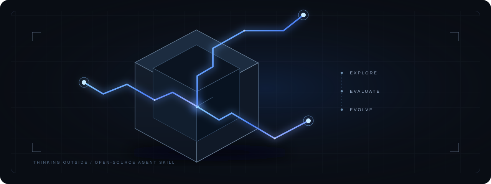

<div align="center">



# Thinking Outside

**Beyond the obvious. Built for what works.**

Uma skill de pensamento criativo aplicado para agentes de IA. Explora mecanismos diferentes, questiona premissas quando necessário e transforma ideias em soluções viáveis — sem ignorar restrições.

[Começar](#instalação) · [Como funciona](#como-funciona) · [Validação](docs/review-1.0.md) · [Licença](LICENSE)

</div>

---

## Como funciona

Em vez de produzir várias versões da mesma ideia, Thinking Outside busca **alternativas que funcionam de maneiras diferentes**.

- **Explore** — encontra mecanismos distintos, não apenas novos nomes ou temas.
- **Evaluate** — compara utilidade, viabilidade, restrições e evidências.
- **Evolve** — melhora propostas com testes, medidas e feedback.
- **Direct** — responde diretamente quando não é preciso explorar alternativas.

Complementa skills de programação, design, jogos e outras áreas. Não exige servidor, banco de dados ou API própria.

## Na prática

> **Pedido:** “Quero três mecânicas para um jogo competitivo no Roblox, sem inventário, níveis ou sorte.”

**Resultado esperado:** três mecanismos com regras e decisões realmente diferentes, limites identificados e restrições preservadas — não três versões de captura de território.

> **Pedido:** “Quanto é 23 × 4?”

**Resultado esperado:** `92`. Sem brainstorming.

## Instalação

O projeto segue o formato [Agent Skills](https://agentskills.io/).

1. Copie a pasta [`thinking-outside/`](thinking-outside/) **inteira** para o diretório de skills do seu agente, incluindo `SKILL.md` e `references/`.
2. Inicie uma nova sessão.
3. Quando o cliente permitir, invoque a skill explicitamente; caso contrário, peça: “Use Thinking Outside para explorar soluções para [problema], respeitando [restrições]”.

A descoberta automática depende do cliente. Consulte a [compatibilidade](docs/compatibility.md).

**Candidata D:** a versão D revisada está no ZIP de validação, mas ainda **não foi promovida** para o `thinking-outside/SKILL.md` canônico do PR #4. Para avaliá-la, veja [instalação do candidato](docs/install-candidate.md) e [teste de ativação no Claude](docs/claude-manual-check.md).

## Validação

**Status: candidata à 1.0, em revisão.** Resultados automatizados não garantem criatividade superior nem substituem avaliação humana cega e verificação da ativação real.

```bash
python tests/validate_repo.py
python -m unittest discover -s tests -p "test_*.py" -v
```

Para validar o formato, após instalar `skills-ref`: `agentskills validate ./thinking-outside`.

[Resultados e pendências](docs/review-1.0.md) · [Benchmark](docs/benchmark.md) · [Critérios de release](docs/release-readiness.md)

<details>
<summary>Mais documentação</summary>

- [Especificação](docs/specification.md)
- [Métodos criativos](docs/creative-methods.md)
- [Arquitetura](docs/architecture.md)
- [Compatibilidade](docs/compatibility.md)
- [Testes de aceitação](thinking-outside/evals/ACCEPTANCE_CASES.md)
- [Roadmap](docs/roadmap.md)
- [Changelog](CHANGELOG.md)

</details>

## Licença

[MIT](LICENSE). A skill não tem custo próprio de infraestrutura; limites e custos do agente utilizado são definidos pelo respectivo provedor.
