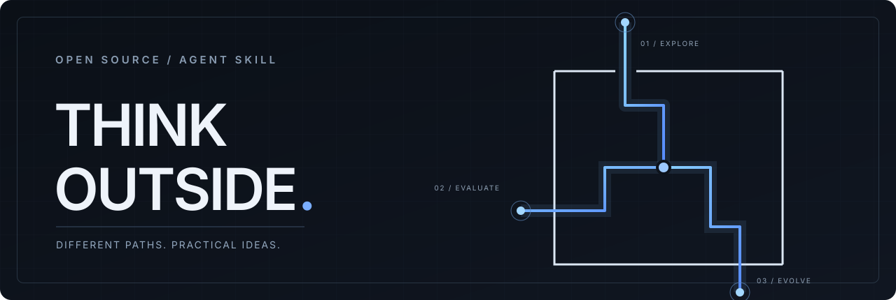

<div align="center">



# Thinking Outside

**Beyond the obvious. Built for what works.**

Uma skill de raciocínio criativo para agentes de IA. Ideias realmente diferentes, decisões mais bem fundamentadas e soluções viáveis — respeitando as restrições do projeto.

**v1.0.0-rc.1 · Release candidate** &nbsp;·&nbsp; **Agent Skills** &nbsp;·&nbsp; **MIT**

[Instalação](#instalação) · [Como funciona](#como-funciona) · [Resultados](#resultados) · [Documentação](#documentação)

</div>

---

## Como funciona

Thinking Outside não gera apenas mais ideias. Ela orienta o agente a procurar **mecanismos distintos**, comparar seus efeitos e desenvolver a alternativa mais útil.

| Capacidade | O que faz |
| --- | --- |
| **Explore** | Descobre abordagens que atuam em pontos diferentes do problema. |
| **Evaluate** | Compara originalidade, diversidade, utilidade, viabilidade e restrições. |
| **Evolve** | Refina hipóteses e propõe testes simples, mensuráveis e reversíveis. |
| **Direct** | Responde diretamente quando brainstorming seria desperdício. |

A skill é um conjunto portátil de instruções Markdown. **Não exige servidor, banco de dados, API própria ou modelos adicionais.** Pode complementar ferramentas de desenvolvimento, jogos, design e pesquisa, mas não substitui a validação técnica dessas áreas.

## Instalação

Baixe o ZIP na [release candidata](https://github.com/God-601/Thinking-Outside/releases/tag/v1.0.0-rc.1) e copie a pasta `thinking-outside/` **inteira**, mantendo o `SKILL.md` e `references/`.

| Agente | Pasta no projeto | Invocação explícita |
| --- | --- | --- |
| **Codex** | `.agents/skills/thinking-outside/` | `$thinking-outside` |
| **Claude Code** | `.claude/skills/thinking-outside/` | `/thinking-outside` |

Reinicie a sessão após instalar. A descoberta automática varia conforme o cliente e **ainda não foi confirmada para todos os ambientes**. Consulte o [guia de ativação](docs/claude-manual-check.md) e a [matriz de compatibilidade](docs/compatibility.md).

### Exemplo

> **Pedido:** “Quero quatro mecânicas competitivas para um jogo Roblox, sem combate, inventário ou sorte.”

**Com a skill:** o agente deve comparar regras e decisões realmente diferentes, identificar estratégias dominantes, respeitar as exclusões e propor um protótipo testável.

> **Pedido:** “Quanto é 23 × 4? Responda só o número.”

**Resultado esperado:** `92`, sem brainstorming.

## Resultados

Nos **testes automatizados com Codex GPT-6.1-Sol (Medium)**, a candidata D revisada obteve **84,4% de preferência** contra o modelo sem skill e **78,1%** contra a versão B anterior, em oito famílias e 16 comparações pareadas por referência. Empates contam como meio ponto.

Esses números são **resultados exploratórios com um avaliador automatizado**, não uma garantia de originalidade nem certificação de ganho em todos os modelos. A revisão humana independente e a validação automática de carregamento ainda estão pendentes.

[Relatório e evidências](docs/review-1.0.md) · [Metodologia](docs/benchmark.md) · [Critérios para release estável](docs/release-readiness.md)

## Documentação

- [Especificação e escopo](docs/specification.md)
- [Arquitetura](docs/architecture.md)
- [Métodos criativos](docs/creative-methods.md)
- [Compatibilidade](docs/compatibility.md)
- [Testes e avaliação](docs/benchmark.md)
- [Changelog](CHANGELOG.md)

<details>
<summary>Validação para contribuidores</summary>

```bash
python tests/validate_repo.py
python -m unittest discover -s tests -p "test_*.py" -v
# Depois de instalar skills-ref:
agentskills validate ./thinking-outside
```

Os testes estruturais verificam layout e consistência. Não medem a qualidade criativa por si mesmos.

</details>

## Licença

[MIT](LICENSE). O uso da skill não envolve infraestrutura paga própria; eventuais custos dependem do modelo e do provedor escolhidos.
